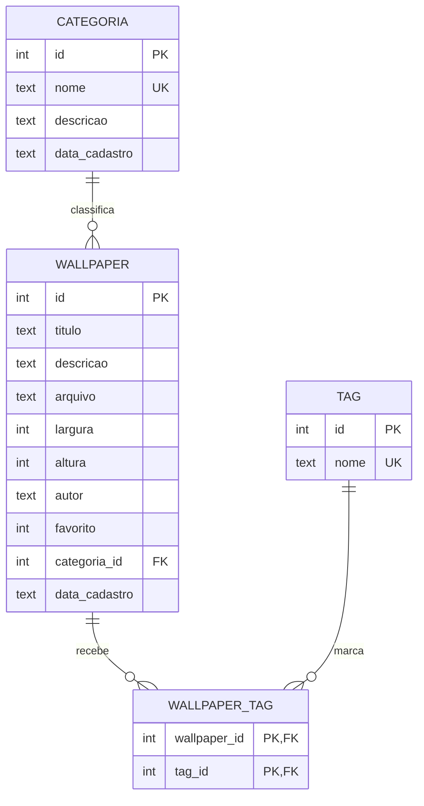

# Modelo de dados — Cadastro de papéis de parede

## Diagrama entidade-relacionamento

## Relacionamentos

| Relação | Cardinalidade | Como funciona |
|---|---|---|
| categoria → wallpaper | 1:N | Um wallpaper tem uma única categoria. A categoria não pode ser excluída enquanto tiver wallpapers (`ON DELETE RESTRICT`). |
| wallpaper ↔ tag | N:N | Um wallpaper tem várias tags e uma tag aparece em vários wallpapers. A tabela `wallpaper_tag` guarda os pares (`ON DELETE CASCADE`). |

## Dicionário de dados

**categoria**

| Campo | Tipo | Regras |
|---|---|---|
| id | INTEGER | Chave primária, automática |
| nome | TEXT | Obrigatório, único, 1 a 40 caracteres |
| descricao | TEXT | Até 200 caracteres |
| data_cadastro | TEXT | Preenchido automaticamente |

**wallpaper**

| Campo | Tipo | Regras |
|---|---|---|
| id | INTEGER | Chave primária, automática |
| titulo | TEXT | Obrigatório, 1 a 80 caracteres |
| descricao | TEXT | Até 300 caracteres |
| arquivo | TEXT | Nome do arquivo em `app/static/uploads` |
| largura, altura | INTEGER | Obrigatórios, maiores que zero (lidos da imagem no upload) |
| autor | TEXT | Até 60 caracteres |
| favorito | INTEGER | 0 ou 1 |
| categoria_id | INTEGER | Chave estrangeira para `categoria` |
| data_cadastro | TEXT | Preenchido automaticamente |

**tag**: `id` (PK), `nome` (único, até 20 caracteres, sempre em minúsculas).

**wallpaper_tag**: `wallpaper_id` + `tag_id` (chave primária composta, as duas são chaves estrangeiras).

## Objetos do banco

- **Índices:** `idx_wallpaper_categoria` e `idx_wallpaper_tag_tag`, para acelerar os JOINs e filtros.
- **View `vw_wallpaper_completo`:** junta wallpaper e categoria e calcula a orientação (Paisagem, Retrato ou Quadrado). A galeria usa essa view.
- **Restrições CHECK:** tamanhos de texto, dimensões positivas e `favorito` em (0, 1).
